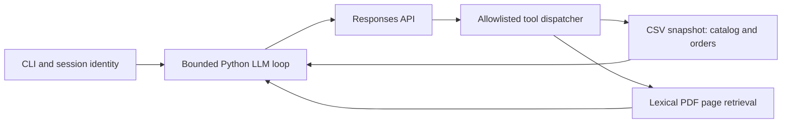

# Mel - Empório da Música

A Python customer-service agent for Artefact's AI Engineer technical case.
Mel combines LLM function calling, deterministic operational lookups and page-level retrieval over the supplied policy PDF. The interface is a small CLI; the focus is grounded answers and explicit uncertainty.

**Validation status:** the local automated suite passes. A live model session has **not yet been run** in the authoring environment because no API key is configured. The five checked-in examples are clearly labeled expected dialogues with executed local-tool evidence, not recorded LLM outputs. Run the live capture command below before treating the model behavior as validated.

## Run

Python 3.11+ is required. Run commands from the repository root (the directory containing this README), because the supplied data lives beside the package. No database server or embedding service is needed.

```bash
python3 -m venv .venv
source .venv/bin/activate
python -m pip install -e '.[dev]'
# Enter your own API key locally; never commit it or share it in chat.
read -s OPENAI_API_KEY
export OPENAI_API_KEY
export OPENAI_MODEL=gpt-4.1-mini
python -m emporio --trace
```

The API consumes paid credits. Model availability and pricing depend on the account; `OPENAI_MODEL` is configurable. `.env.example` lists the settings, but the application does not automatically load `.env` files. On Windows PowerShell use `.venv\Scripts\Activate.ps1` and set environment variables using `$env:NAME`.

Type `/reset` to clear conversation history or `/exit` to quit. History is session-only, bounded to eight exchanges; nothing is written to disk. `--trace` prints tool names only.

Order access is denied in the default anonymous session. To exercise the fictional customer fixture locally:

```bash
python -m emporio --demo-customer-id 3
# Ask: What is the status of order 1?
```

This flag is an evaluator convenience, **not production authentication**. A deployed interface must bind customer identity to a verified account or signed channel session, remove this flag, and never accept customer identity from the LLM. An order number alone never authorizes access. The application never sends `customers.csv` to the model.

## Verify without an API key

```bash
python -m pytest -q
python -m emporio.evidence
```

Tests exercise real local CSV/PDF tools and a scripted Responses client for protocol behavior. They cover inventory and budget filters; active vs inactive promotions; PIX non-cumulativity; cross-customer isolation; fresh reads after an inventory change; English/Portuguese policy queries; tool argument and identity injection; malformed tool JSON; lookup limits; provider failure; and bounded conversation history. Scripted-client tests do not measure real model quality.

## Capture actual model conversations

```bash
python -m emporio.capture --output live_examples
```

This runs five scenarios against the configured API and writes real responses plus tool names to a new directory. It makes paid API calls. Review these outputs for correctness and copy approved captures into `examples/` before final submission. No claims of measured latency, cost, hallucination rate or live evaluation results are made in this version.

## Architecture and decisions



- **Approach:** hybrid tool calling plus retrieval. Tabular facts are computed in Python; the PDF provides policy evidence. No arbitrary SQL or code execution is exposed. Tool results return to the LLM for a natural response.
- **Framework:** direct OpenAI SDK and a short explicit orchestration loop. A larger agent framework or vector database would add setup without improving this eight-page, 65-product prototype enough to justify it.
- **LLM/provider:** OpenAI Responses API with `gpt-4.1-mini` as a configurable starting choice for a small tool-oriented task. This is an implementation choice, not a claim that it is the latest or cheapest model. The model can be changed without modifying business tools. See [official function-calling documentation](https://developers.openai.com/api/docs/guides/function-calling).
- **Retrieval:** extract the original PDF once per session with PyMuPDF, rank pages lexically with accent normalization and a small English/Portuguese synonym map, and return the three best matches with physical PDF page numbers. No embedding API is necessary. The tradeoff is weaker recall for unusual paraphrases; semantic retrieval and a labeled retrieval evaluation would be the next improvement.
- **Prompt:** Mel is warm and practical, answers in English for the evaluation, cites policy pages, consults tools for changing facts, and explains missing evidence. Source text is reference data, never an instruction. First-step tool use is required; subsequent steps are bounded to six model calls per turn. These controls reduce risk but do not guarantee factual or injection-proof model output.
- **Session:** in-memory final user/assistant dialogue only, at most eight exchanges. Raw PDF/tool outputs are not retained across turns, and fresh facts must be retrieved again. `store=False` requests no Responses object storage; this is not a promise about all provider retention policies.
- **Data:** all six supplied CSVs and the original policy PDF are included as fictional case materials. IDs, stock and quantities are cast as integers at the tool boundary; JSON specifications are parsed; money uses `Decimal` and cent rounding. Product queries join categories/promotions, exclude unavailable models by default and return the cheapest ten matching products. Specific-model lookups can include unavailable items. Order results omit customer contact details and free-text notes.
- **Tradeoff:** direct CSV reads are simple at this scale and refresh on each tool call. This is not a live commerce integration and does not provide transactional consistency across simultaneous file edits. A real service needs a database and inventory API with stable snapshots.

## Business rules and assumptions

1. `is_active=1` is the only supplied promotion validity indicator. The data contains no start/end dates. A campaign name or current month cannot activate it. If several active promotions apply, use the largest percentage, never stack them. Discounts apply only to currently available products. Show original price, current price and discount. PIX is 5% off list price only without an active promotion.
2. The policy has conflicting installment minima (general payment table versus detailed tiers), two WhatsApp numbers, and an undefined shipping boundary at exactly BRL 500. Explain the relevant ambiguity and defer to staff. Do not invent a precedence rule.
3. Orders contain an estimated delivery date, but no actual receipt date or online/in-store channel. Returns therefore require clarification, not an automatic decision from `order_date`. Historical delivery estimates must never become a new delivery promise. Source policy statements are not legal determinations; ambiguous restrictions require human review.
4. Data is the historical snapshot supplied by the case. Re-reading it at query time demonstrates tool-grounded access, not live store connectivity. Cancelled/pending orders do not expose a tracking code as a shipment confirmation.
5. The request for English responses applies to README, examples and agent output; original Portuguese source materials remain unchanged.
6. The attached case requests a public GitHub link by reply email, while the invitation requests a PDF through Forms. Prepare a short PDF with the final repository URL and frozen commit, and supply the same link by email. Do not change the repository after delivery. Resolve publication and live evaluation before the freeze.

## Examples

The five `.md` files in `examples/` cover budget search and follow-up price, a store address, a discounted product with PIX, conditional returns, and scope/privacy boundaries. `python -m emporio.evidence` regenerates their factual tool evidence. Expected assistant wording is manually authored and labeled; these examples must not be represented as real API transcripts.

## Known limitations and next steps

No live LLM run has been verified in this environment. Test multilingual paraphrases, follow-up references, policy ambiguity and adversarial requests against the real model before delivery. Authentication, a web UI, WhatsApp integration, ticket creation, checkout and real inventory APIs are intentionally not implemented. The prototype can explain a policy but cannot authorize refunds or submit complaints. There is no production monitoring, holiday-calendar service, semantic retrieval evaluation or concurrency control. The model can still misinterpret evidence; a production system needs evaluated guardrails and structured response validation.

Next steps: verify live conversations and save their traces; add a small gold evaluation set; resolve policy conflicts with the owner; replace the demo identity with verified sessions; then add a minimal web/WhatsApp adapter and observability with redacted logs. Pin an exact tested dependency lock when the target deployment environment is fixed.

## AI coding assistance disclosure

OpenAI Codex assisted with reading the assignment, drafting Python code, business-rule review, automated tests, documentation and expected examples. The work was developed in successive local commits representing actual implementation stages. Live language-model behavior has not been verified yet; the authoring agent has not invented API execution results. The candidate should review and understand the implementation, validate live examples, and revise decisions as needed before submission.
