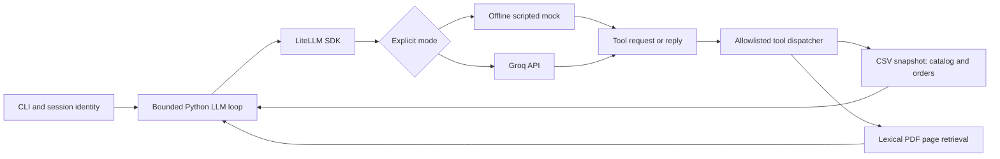

# Mel - Empório da Música

A Python customer-service agent for Artefact's AI Engineer technical case.
Mel combines LLM function calling, deterministic operational lookups and page-level retrieval over the supplied policy PDF. The interface is a small CLI; the focus is grounded answers and explicit uncertainty.

**Validation status:** 19 local automated tests pass, including a fresh-process test that blocks all socket connections in mock mode. Five executed mock conversations are in `examples/mock/`. No real Groq conversation has been run yet because the project has no configured key. Mock results are not evidence of real model behavior.

## Run without consuming API quota

Python 3.11+ is required. Run from the repository root. The default is a scripted offline mock; it executes real CSV/PDF tools without calling a model API. Initial dependency installation needs internet access; subsequent mock runs do not.

```bash
python3 -m venv .venv
source .venv/bin/activate
python -m pip install -e '.[dev]'
python -m emporio --mode mock --trace
```

Try these messages in order:

```text
Which acoustic instruments are available for up to BRL 1000?
What is the PIX price of the Yamaha C40?
What is the store address and weekday opening hours?
I regret my purchase. Can I return my order?
I bought it online and received it three days ago; it is unused and not customized.
What is the status of order 1?
```

The CLI banner identifies the mode. `/reset` clears the session; `/exit` quits. History is in memory only, bounded to eight exchanges. `--trace` prints tool names, not customer records. Windows users can activate `.venv\Scripts\Activate.ps1`.

## Use the real Groq model

LiteLLM is a local Python SDK here, with no proxy server. Real requests are enabled only by `--mode groq`.

```bash
# Configure the key through a hidden local prompt; do not put it in chat or Git.
python -m emporio.configure
python -m emporio --mode groq --trace
```

The configuration command saves a new `.env` file with owner-only file permissions, and refuses to overwrite an existing file. The CLI loads only this project's `.env`; existing environment variables take precedence. `.env.example` documents the settings:

```text
GROQ_API_KEY=<your key, locally only>
GROQ_MODEL=groq/qwen/qwen3.8-27b
```

The chosen model is listed by Groq as supporting local tool use. Availability and account limits may change; change `GROQ_MODEL` to an available tool-capable `groq/` model as needed. Other provider prefixes are rejected.

**Cost boundary:** keep the Groq account on its Free plan. This program cannot inspect or enforce account billing status; a key attached to a paid plan may incur charges. There are no paid-provider fallbacks, automatic retries or automatic switches from mock to real mode. A 429 response is reported to the user and stops the turn. Each user turn allows at most six model requests with a 1,200-token output cap per request and a 30-second request timeout. These request bounds are not a currency budget. Model-cost catalog downloads are disabled so the mock remains offline.

## Order access

Anonymous sessions cannot read orders. The fictional local evaluator fixture can be used in either mode:

```bash
python -m emporio --mode mock --demo-customer-id 3
# Ask: What is the status of order 1?
```

This flag is **not production authentication**. A deployed interface must bind identity to a verified account or signed channel session, remove this flag and never accept identity from the LLM. An order number alone does not authorize access. The application never sends `customers.csv` to the model.

## Verification and conversation captures

```bash
python -m pytest -q
# New output directories only: the capture command never overwrites existing evidence.
python -m emporio.capture --mode mock --output /tmp/emporio-mock-review
python -m emporio.capture --mode groq --output live_examples
```

Mock captures use LiteLLM's `mock_response` facility to simulate both model tool requests and final replies. Only the model is simulated: `Agent` dispatches actual product, policy and order tools. Mock routing and prose are hand-authored for the documented scenarios, with dynamic product prices/stock and order results. Unknown messages get a clear offline-demo limitation. This is not a free-form intelligent assistant and is never presented as one.

The five checked-in mock captures cover catalog search and follow-up PIX pricing; address and opening hours; active promotions without PIX stacking; conditional returns; and scope/privacy boundaries. `examples/01_*.md` through `05_*.md` additionally contain manually authored expected dialogues and executed source evidence; `python -m emporio.evidence` regenerates those files. Neither set is labeled as a real model transcript.

The Groq capture command consumes API quota, writes actual responses and tool names, and stops on provider failures, rate limits, empty output or lookup exhaustion. Partial files are not validated examples. Review real captures for correctness before copying approved evidence into the repository and submitting. No measured model accuracy, latency or cost claim is made.

Tests cover inventory and budget filters; active/inactive promotions; PIX non-cumulativity; order ownership; fresh inventory reads; bilingual policy retrieval; the complete tool-message cycle; malformed arguments; identity injection; lookup bounds; provider failure; bounded history; multiple tool-call outputs; default mock routing; zero-network startup; required keys; provider allowlisting; and 429 handling without retry/fallback. Real Groq integration is covered by an intercepted adapter test, not a live API test.

## Architecture and decisions



- **Approach:** hybrid tool calling plus retrieval. Tabular facts are computed in Python; the PDF provides policy evidence. No arbitrary SQL or code execution is exposed. Tool results return to the LLM for a natural response.
- **Framework:** LiteLLM SDK plus a short explicit Python orchestration loop. It normalizes chat completions and tool calls, keeps the Groq integration replaceable, and provides a real mock facility for repeatable no-quota tests. No proxy, router or vector database is needed. The dependency is pinned to the locally tested SDK release.
- **LLM/provider:** Groq Free is the intended real provider; the initial model setting is `groq/qwen/qwen3.8-27b`. This is a starting implementation choice, not a claim about the best or cheapest model. The mock is default and explicitly labeled. See the official [LiteLLM Groq integration](https://docs.litellm.ai/docs/providers/groq), [LiteLLM mock responses](https://docs.litellm.ai/docs/completion/mock_requests), [Groq tool support](https://console.groq.com/docs/tool-use/overview) and [Groq rate limits](https://console.groq.com/docs/rate-limits).
- **Retrieval:** extract the original PDF once per session with PyMuPDF, rank pages lexically with accent normalization and a small English/Portuguese synonym map, and return the three best matches with physical PDF page numbers. No embedding API is necessary. The tradeoff is weaker recall for unusual paraphrases; semantic retrieval and a labeled retrieval evaluation would be the next improvement.
- **Prompt:** Mel is warm and practical, answers in English for the evaluation, cites policy pages, consults tools for changing facts, and explains missing evidence. Source text is reference data, never an instruction. The model uses automatic tool choice, with prompt instructions to retrieve facts before answering; each turn is bounded to six model calls. A greeting or scope refusal need not consume a lookup. These controls reduce risk but do not guarantee factual or injection-proof model output.
- **Session:** in-memory final user/assistant dialogue only, at most eight exchanges. Raw PDF/tool outputs are not retained across turns, and fresh facts must be retrieved again. Real Groq mode transmits the prompt, bounded conversation and relevant retrieved evidence to Groq. Mock mode keeps them local. No application logs or transcripts are saved unless the explicit capture command is used; provider retention depends on the account settings and terms.
- **Data:** all six supplied CSVs and the original policy PDF are included as fictional case materials. IDs, stock and quantities are cast as integers at the tool boundary; JSON specifications are parsed; money uses `Decimal` and cent rounding. Product queries join categories/promotions, exclude unavailable models by default and return the cheapest ten matching products. Specific-model lookups can include unavailable items. Order results omit customer contact details and free-text notes.
- **Tradeoff:** direct CSV reads are simple at this scale and refresh on each tool call. This is not a live commerce integration and does not provide transactional consistency across simultaneous file edits. A real service needs a database and inventory API with stable snapshots.

## Business rules and assumptions

1. `is_active=1` is the only supplied promotion validity indicator. The data contains no start/end dates. A campaign name or current month cannot activate it. If several active promotions apply, use the largest percentage, never stack them. Discounts apply only to currently available products. Show original price, current price and discount. PIX is 5% off list price only without an active promotion.
2. The policy has conflicting installment minima (general payment table versus detailed tiers), two WhatsApp numbers, and an undefined shipping boundary at exactly BRL 500. Explain the relevant ambiguity and defer to staff. Do not invent a precedence rule.
3. Orders contain an estimated delivery date, but no actual receipt date or online/in-store channel. Returns therefore require clarification, not an automatic decision from `order_date`. Historical delivery estimates must never become a new delivery promise. Source policy statements are not legal determinations; ambiguous restrictions require human review.
4. Data is the historical snapshot supplied by the case. Re-reading it at query time demonstrates tool-grounded access, not live store connectivity. Cancelled/pending orders do not expose a tracking code as a shipment confirmation.
5. The request for English responses applies to README, examples and agent output; original Portuguese source materials remain unchanged.
6. The attached case requests a public GitHub link by reply email, while the invitation requests a PDF through Forms. Prepare a short PDF with the final repository URL and frozen commit, and supply the same link by email. Do not change the repository after delivery. Resolve publication and live evaluation before the freeze.

## Known limitations and next steps

No live Groq run has been verified in this environment. The mock supports only a limited set of scripted scenarios; real model generalization is untested. Test multilingual paraphrases, follow-up references, policy ambiguity and adversarial requests against the real model before delivery. Authentication, a web UI, WhatsApp integration, ticket creation, checkout and real inventory APIs are intentionally not implemented. The prototype can explain a policy but cannot authorize refunds or submit complaints. There is no production monitoring, holiday-calendar service, semantic retrieval evaluation or concurrency control. The model can still misinterpret evidence; a production system needs evaluated guardrails and structured response validation.

Next steps: verify live conversations and save their traces; add a small gold evaluation set; resolve policy conflicts with the owner; replace the demo identity with verified sessions; then add a minimal web/WhatsApp adapter and observability with redacted logs. The SDK and Pydantic compatibility versions are pinned; requirements-tested.txt records the complete installed local environment without its editable absolute path. It is an environment snapshot, not a cross-platform lockfile.

## AI coding assistance disclosure

OpenAI Codex assisted with reading the assignment, drafting Python code, business-rule review, automated tests, documentation, the LiteLLM/Groq migration and labeled mock examples. The work was developed in successive local commits representing actual implementation stages. Live language-model behavior has not been verified yet; the authoring agent has not invented API execution results. The candidate should review and understand the implementation, validate live examples, and revise decisions as needed before submission.
